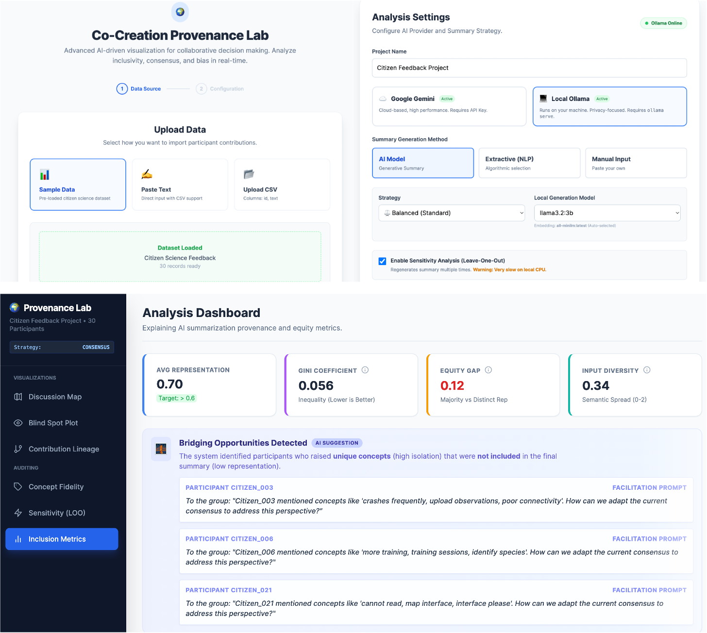

# Co-Creation Provenance Lab



A tool for auditing how AI-generated summaries represent diverse participant inputs in co-creation processes. It measures whether every voice is captured fairly, identifies blind spots and at-risk participants, diagnoses the root cause of underrepresentation, and provides actionable recommendations for more inclusive summarization.

## What It Does

### Representation Auditing
- **Representation scoring** — measures how well each participant's input is reflected in the final AI summary using hybrid scoring: 80% semantic similarity (cosine similarity over distributed sentence matches with exponential decay) + 20% concept overlap, or 50/50 for TF-IDF embeddings
- **Blind spot detection** — identifies unique voices (low centrality + score below threshold) that were genuinely missed, not just relatively lower
- **Equity metrics** — Gini coefficient, distinct representation gap, and coverage uniformity across all participants
- **Leave-One-Out sensitivity analysis** — shows which inputs most influence the summary's semantic direction, with Bessel-corrected Z-score normalization
- **Concept fidelity analysis** — tracks which key concepts were preserved, dropped, or added during summarization using stemmed matching
- **Tone distortion detection** — flags participants whose sentiment polarity conflicts with their primary matched summary sentence

### Equity & Fairness
- **Language equity analysis** — permutation test (10,000 permutations) to detect whether non-English inputs are statistically underrepresented vs English inputs (p < 0.05 threshold)
- **Stakeholder group equity** — compares representation across defined groups (community, expert, youth, government, business) with inter-group Gini
- **Bootstrap confidence intervals** — 200-sample bootstrap resampling for Gini, average representation, and equity gap metrics (quantifies sampling variability)
- **Threshold sensitivity analysis** — shows how metric counts change as representation and isolation thresholds vary

### Explainability
- **Bias source attribution** — for every underrepresented participant (score < 0.6), diagnoses the primary cause:
  - *Embedding Gap* — TF-IDF fallback used for non-Latin script, reducing multilingual reliability
  - *Unique Voice* — semantically isolated perspective with mostly unique keywords; genuine content gap, not a modeling artifact
  - *Summarizer Bias* — the LLM detected semantic relevance but chose not to include the perspective; other participants covering similar topics are better represented
  - *Phrasing Mismatch* — mainstream ideas expressed in non-standard phrasing that diverges from the summary's language
- **Counterfactual suggestions** — per-participant edit hints (keyword emphasis, phrasing alignment, tone adjustment) with estimated representation impact
- **Anomaly detection** — flags keyword stuffing, copy-paste inputs, and statistical outliers

### Action & Intervention
- **Facilitation Co-Pilot** — LLM-powered facilitation plan generated from the analysis: a facilitator-ready gap brief, 5 targeted follow-up questions addressing specific blind spots, and 3 evidence-based workshop exercises (World Café, Fishbowl, Anonymous Voting); falls back to rule-based templates when offline
- **Interactive revision editor** — manually edit or AI-generate a revised summary and compare before/after metrics side-by-side
- **Consultation Planner (What-If Simulator)** — client-side parametric simulation of two scenarios:
  - *Add Voices* — projects fairness metrics if N synthetic participants from a selected cluster were added (parametric bootstrap from cluster's empirical score distribution)
  - *Reweight Group* — projects what happens if a stakeholder group's representation scores were multiplied by a chosen factor
- **Strategy comparison** — run all three summarization strategies (Balanced / Diversity / Consensus) and compare their equity metrics side-by-side

### Validation & Provenance
- **Participant validation loop** — facilitators submit per-participant feedback (Accurate / Missed / Distorted); Spearman calibration score measures human-algorithm agreement; agreement matrix surfaces false positives and negatives; import responses from the offline verification page
- **Participant verification page** — download a standalone HTML file for participants to verify their own representation; responses can be imported back into the tool
- **W3C PROV-O export** — machine-readable audit certificate in JSON-LD format documenting the full analysis provenance
- **HTML report export** — formatted report for stakeholder distribution

---

## AI Providers

The tool supports three AI providers, switchable in the configuration panel.

| Provider | Summary Generation | Embeddings | Setup |
|---|---|---|---|
| **Google Gemini** ☁️ | ✅ Cloud (via proxy on Vercel) | ✅ text-embedding-004 | API key (free at [ai.google.dev](https://aistudio.google.com)) |
| **Groq** ⚡ | ✅ Llama 3, Gemma 2, Mixtral | ❌ Falls back to TF-IDF / BGE-M3 | Free API key at [console.groq.com](https://console.groq.com) |
| **Ollama** 💻 | ✅ Any local model | ✅ all-minilm or any embed model | Local install, 100% private |

### Embedding Fallback Chain

Embeddings drive all representation scores. The tool selects the best available tier automatically:

| Priority | Model | Quality | Requirement |
|---|---|---|---|
| 1 | **BGE-M3** (BAAI) | State-of-the-art, multilingual | `python embedding_server.py` |
| 2 | **Ollama** embeddings | Good | `ollama pull all-minilm` |
| 3 | **Gemini** text-embedding-004 | Good | Gemini API key |
| 4 | **Local TF-IDF** | Basic (always available) | Nothing — automatic fallback |

BGE-M3 is recommended for multilingual datasets. TF-IDF uses Unicode-aware tokenization supporting Latin, CJK (character bigrams), Arabic, Devanagari, Cyrillic, Thai, Hebrew, and Greek scripts.

---

## Quick Start (Local Development)

### Prerequisites

- Node.js v18+
- Python 3.10+ (optional, for BGE-M3 embedding server)
- Ollama (optional, for local LLM)

### 1. Install dependencies

```bash
npm install
```

### 2. (Optional) Start the BGE-M3 embedding server

```bash
pip install sentence-transformers flask flask-cors
python embedding_server.py
```

> On first run, BGE-M3 downloads ~2 GB of model weights. This only happens once.
> If you get a `torch.load` / CVE-2025-32434 error: `pip install 'transformers<4.50'`

### 3. (Optional) Start Ollama

```bash
ollama pull qwen3:30b-instruct        # generation model
ollama pull all-minilm:latest         # embedding fallback
OLLAMA_ORIGINS="*" ollama serve
```

> `OLLAMA_ORIGINS="*"` is handled automatically via the Vite dev proxy — you no longer need to set it manually when using `npm run dev`.

### 4. Start the dev server

```bash
npm run dev
```

Open `http://localhost:3000`.

### 5. Set API keys (optional)

**Option A — Environment variable** (persists across sessions):
```bash
# .env (local dev only — never committed)
GEMINI_API_KEY=AIza...
GROQ_API_KEY=gsk_...
```

**Option B — Browser UI** (stored in sessionStorage, cleared when tab closes):
Select your provider in the configuration panel and paste the key into the field that appears. No server receives this key.

---

## Vercel Deployment

### Environment variables

| Variable | Purpose |
|---|---|
| `GEMINI_API_KEY` | Used **server-side** by the `/api/gemini-*` serverless functions. Users do not need to enter a key. |
| `GROQ_API_KEY` | No server-side proxy exists for Groq. Users enter their own free key in the browser UI. |

### Gemini proxy

Four serverless functions handle all Gemini requests server-side:

```
/api/gemini-health    → health check
/api/gemini-models    → list available models
/api/gemini-embed     → generate embeddings
/api/gemini-complete  → generate text completions
```

The browser never sees the `GEMINI_API_KEY`. In local development the SDK falls back to the key in `.env`.

---

## One-Command Docker Setup

```bash
docker compose up
```

Or use the startup script on Mac/Linux:

```bash
chmod +x start.sh && ./start.sh
```

---

## Usage

1. **Load data** — Use the sample dataset, paste inputs, or upload a CSV with columns `id`, `text`, and optionally `stakeholder_group`
2. **Choose provider** — Gemini (cloud), Groq (free cloud), or Ollama (local)
3. **Configure** — Pick summarization strategy (Balanced / Diversity / Consensus), model, and optional features (LOO analysis, NLI, anomaly detection, group analysis)
4. **Run analysis** — The AI generates a summary; the tool scores every participant's representation and computes all equity metrics
5. **Review the dashboard**:
   - **Representation Audit** card — overall score, at-risk count, blind spot count, key concerns
   - **What Was Missed** — underrepresented voices grouped by cluster with suggested additions
   - **Visualizations** — Semantic Map, Blind Spot Plot, Contribution Lineage, Concept Fidelity, Inclusion Metrics, Sensitivity (LOO), Group Equity, Uncertainty, Consultation Planner
   - **Details Panel** — select any participant to see their score, bias attribution, counterfactual hints, and submit validation feedback
6. **Generate a facilitation plan** — click "🧭 Facilitation Co-Pilot" in the sidebar to produce a gap brief, follow-up questions, and workshop exercises based on the analysis
7. **Simulate scenarios** — use the Consultation Planner tab to project how adding voices from a cluster or reweighting a stakeholder group would affect equity metrics
8. **Revise the summary** — click "Revise Summary" to open the interactive editor:
   - Edit manually, or click **✨ Generate AI Draft** for an AI-assisted revision targeting underrepresented voices
   - Click **Apply & Compare** to recompute scores and see before/after metrics
9. **Validate** — submit per-participant feedback to measure human-algorithm agreement; import offline participant verification responses
10. **Export** — download the HTML report, W3C PROV-O audit certificate (JSON-LD), or participant verification page

### CSV Input Format

The tool auto-detects columns named `id`/`participant_id`, `text`/`contribution`, and `group`/`stakeholder_group`/`role`. Headers are optional.

```csv
participant_id,contribution,stakeholder_group
P001,"We need more accessible reporting tools.",community
P002,"As an urban planner, I recommend sustainable drainage systems.",expert
P003,"Young people want more bike lanes.",youth
P004,"The city budget should prioritize infrastructure maintenance.",government
P005,"Local businesses would benefit from improved parking facilities.",business
```

A downloadable template is available in the configuration panel.

---

## Methodology Notes

### Representation Scoring

Each participant's representation score is computed as a weighted combination of:
- **Embedding similarity** — cosine similarity between the participant's input embedding and summary sentence embeddings, aggregated across all matching sentences with exponential decay on secondary matches (γ = 0.3)
- **Concept overlap** — keyword-level matching using stemmed comparison

For neural embeddings (BGE-M3, Gemini, Ollama): 80% embedding similarity + 20% concept overlap.
For TF-IDF fallback: 50/50.

### Blind Spot Definition

A participant is a blind spot when:
1. Their centrality (1 − semantic isolation) is below the median centrality of all participants — meaning their perspective is peripheral
2. Their representation score is below 0.5 (the "low" interpretation band) — meaning they are genuinely underrepresented, not just relatively lower

This avoids the purely relative median-quadrant definition, which would always flag ~25% of participants as blind spots regardless of actual representation quality.

### Metric Thresholds

| Metric | Threshold | Justification |
|---|---|---|
| Well represented | score ≥ 0.6 | Cosine similarity > 0.6 indicates "similar" content (Mihalcea & Tarau, 2004) |
| Marginal | 0.5 ≤ score < 0.6 | Standard "related" content threshold in IR systems |
| Underrepresented | 0.3 ≤ score < 0.5 | Weak semantic relationship |
| At risk | score < 0.3 | Near-absent from the summary |
| Gini low | < 0.2 | Low inequality |
| Gini moderate | 0.2 – 0.35 | Moderate inequality |
| Gini high | > 0.35 | High inequality |

### Clustering

K-Means with K-Means++ initialization (Arthur & Vassilvitskii, 2007) and elbow method for automatic K selection. PCA via power iteration with deflation for 2D visualization.

### Bootstrap Confidence Intervals

Bootstrap CIs (Efron & Tibshirani, 1993) quantify sampling variability — how much aggregate metrics (Gini, mean representation, equity gap) would change if a different sample of participants had been drawn from the same population. They do not capture measurement uncertainty from the embedding model.

### What-If Simulation

Synthetic scores are sampled from a Normal distribution parameterized by the target cluster's empirical mean and Bessel-corrected standard deviation (minimum σ = 0.05). Results are probabilistic and should be treated as directional projections, not precise forecasts.

---

## Architecture

```
Browser
  │
  ├── /api/ollama/*  ──proxy──▶  http://localhost:11434  (Ollama, local dev)
  │
  ├── /api/gemini-* ──proxy──▶  Vercel serverless functions
  │                              └── GEMINI_API_KEY (server-side only)
  │
  └── https://api.groq.com  ◀── direct fetch (user's own key, sessionStorage)

Embedding pipeline (auto-selected, best available):
  BGE-M3 (localhost:5001) → Ollama → Gemini → Local TF-IDF
```

---

## Project Structure

```
co-creation-provenance-lab/
├── embedding_server.py                  # BGE-M3 Python embedding server
├── api/
│   ├── gemini-health.ts                 # Vercel: proxy health check
│   ├── gemini-models.ts                 # Vercel: list Gemini models
│   ├── gemini-embed.ts                  # Vercel: generate embeddings
│   └── gemini-complete.ts               # Vercel: generate completions
├── services/
│   ├── analysis.ts                      # Core analysis pipeline
│   ├── gemini.ts                        # Gemini client (proxy + direct SDK)
│   ├── groq.ts                          # Groq client (free tier, OpenAI-compatible)
│   ├── ollama.ts                        # Ollama client (via Vite dev proxy)
│   ├── bgeM3.ts                         # BGE-M3 embedding client
│   ├── biasAttribution.ts               # Bias source attribution (4-cause diagnosis)
│   ├── facilitationCoPilot.ts           # Facilitation plan generation (LLM + rule fallback)
│   ├── whatIfSimulation.ts              # Parametric what-if scenario simulation
│   ├── summaryRevision.ts               # Interactive summary revision + score recomputation
│   ├── provenanceExport.ts              # W3C PROV-O JSON-LD certificate export
│   ├── participantVerification.ts       # Standalone HTML verification page
│   ├── languageDetection.ts             # Unicode script detection + permutation test equity
│   ├── counterfactual.ts                # Per-participant edit hints
│   ├── anomalyDetection.ts              # Keyword stuffing, copy-paste, outlier detection
│   ├── uncertainty.ts                   # Bootstrap confidence intervals
│   ├── groupAnalysis.ts                 # Stakeholder group equity metrics
│   ├── reportExport.ts                  # HTML report export
│   └── vectorizer.ts                    # Local TF-IDF fallback (Unicode-aware tokenizer)
├── components/
│   ├── ui/
│   │   ├── ConfigPanel.tsx              # Multi-provider config + CSV upload
│   │   ├── ExecutiveSummary.tsx         # Top-level audit scorecard
│   │   ├── BeforeAfterComparison.tsx    # Revision impact metrics
│   │   ├── FacilitationCoPilotPanel.tsx # Facilitation plan (gap brief, questions, exercises)
│   │   ├── BiasAttributionBadge.tsx     # Per-participant bias cause diagnosis
│   │   ├── FeedbackAnalytics.tsx        # Human-algorithm calibration analytics
│   │   ├── WhatIfSimulator.tsx          # Interactive scenario planner
│   │   ├── CounterfactualPanel.tsx      # Summary edit hints
│   │   ├── FeedbackPanel.tsx            # Per-participant validation feedback
│   │   └── MissedPerspectives.tsx       # Missed voices panel
│   └── visualizations/
│       ├── SemanticMap.tsx              # 2D semantic space (PCA)
│       ├── BlindSpotPlot.tsx            # Centrality vs. representation quadrant
│       ├── RepresentationBar.tsx        # Per-participant score bars
│       ├── SensitivityChart.tsx         # LOO sensitivity chart
│       ├── ConceptDistortion.tsx        # Concept fidelity visualization
│       ├── GroupEquityChart.tsx         # Stakeholder group equity
│       ├── UncertaintyViz.tsx           # Bootstrap confidence intervals
│       └── ThresholdSensitivityMini.tsx # Threshold sensitivity curves
├── types.ts                             # TypeScript interfaces
├── constants.ts                         # Thresholds and analysis configuration
├── vite.config.ts                       # Dev proxy (Ollama + Gemini health)
├── docker-compose.yml                   # Full-stack Docker setup
├── start.sh                             # Mac/Linux one-command startup
└── vercel.json                          # Vercel routing config
```

---

## Troubleshooting

**BGE-M3 torch error on startup:**
```
ValueError: Due to a serious vulnerability issue in torch.load...
```
Fix: `pip install 'transformers<4.50'`

**Ollama shows "Offline" in the config panel:**
The Vite dev proxy handles Ollama CORS automatically. Make sure Ollama is running (`ollama serve`) and you're on `npm run dev`. No need to set `OLLAMA_ORIGINS`.

**Gemini model dropdown shows a text field instead of a dropdown:**
The model list is fetched after you enter your API key. If it doesn't populate, check that the key field shows "✓ Browser key active".

**Scores seem low on non-English inputs:**
Check the embedding tier shown in the Details Panel. BGE-M3 produces the most reliable multilingual scores. If TF-IDF is active, start the BGE-M3 server or configure a Gemini/Ollama embedding model. The Bias Attribution badge will also flag this as an Embedding Gap.

**Facilitation Co-Pilot uses rule-based output instead of LLM:**
This happens when the LLM response could not be parsed (e.g., the model produced free-form text instead of the structured format). The fallback is intentional — it ensures you always get a usable plan. For best results, use Gemini 2.0 Flash or a Groq model.

**Reweight Group shows "No stakeholder groups detected":**
Stakeholder groups must be assigned at input time via the `stakeholder_group` CSV column. The demo data does not include group assignments. Use the "Add Voices" scenario instead, which works with clusters (always available).

**What-If simulation gives different results on each run:**
The "Add Voices" scenario samples synthetic scores from a Normal distribution, so results vary slightly between runs. This is expected — results are directional projections, not deterministic forecasts. Running the simulation a few times gives a sense of the variability.

---

## License

[GNU Affero General Public License v3.0 (AGPL-3.0)](LICENSE)

## Author

**Sachit Mahajan** — [sachitmahajan90@gmail.com](mailto:sachitmahajan90@gmail.com)
