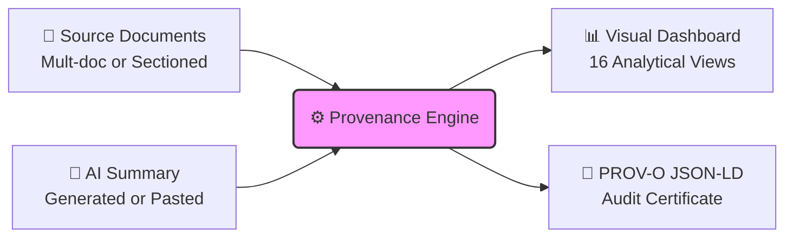

<div align="center">


<br/>

# 🔬 Provenance Lab

### *An open-source visual analytics engine for mapping the provenance, explainability, and representation of LLM-generated summaries.*

<br/>

[](https://co-creation-provenance-tool.vercel.app)
[](https://www.gnu.org/licenses/agpl-3.0)
[](#)
[](#)

[The Problem](#-the-problem) · [How It Works](#-how-it-works) · [Analysis Features](#-analysis-features) · [Quick Start](#-quick-start) · [Methodology](#-methodology)

</div>

---

## 🎯 The Problem

As Large Language Models (LLMs) are increasingly deployed to synthesize complex datasets — from stakeholder consultations and research literature to organizational reports — a critical challenge emerges: **synthesis is inherently reductive**. 

AI-generated summaries naturally amplify majority viewpoints while flattening minority perspectives. Crucial nuances in interpretation are often smoothed over, and the mathematical distance between original source evidence and the final executive summary remains invisible to the end user. This creates a fundamental gap in AI explainability and trust.

**Provenance Lab bridges this gap.** It is an auditing engine that sits between your source documents and any generated summary. By producing a complete, mathematically grounded provenance trail, it makes the LLM's synthesis process fully transparent, interpretive leaps explicitly visible, and representation equity quantifiable.

---

## ⚙️ How It Works



> **Privacy-first**: All analysis runs completely in-browser. No data leaves your machine unless you opt into a cloud LLM provider API.

---

## 🔬 Analysis Features

### 1. Epistemic Classification

The engine evaluates every sentence in the summary to classify its epistemological grounding in the source material, providing deep interpretability into the AI's reasoning:

| Class | Label | Explainability Meaning |
|:---:|:---|:---|
| 🟢 | **Explicit** | Claim is directly stated or closely paraphrased from source text. |
| 🔵 | **Inferred** | Claim is a reasonable derivation or synthesis from available evidence. |
| 🟠 | **Extrapolated** | Claim represents a logical leap beyond direct evidence. |
| 🟣 | **Speculative** | Claim lacks grounding in the provided source material. |

### 2. Language Fidelity Tracking

The tool measures exactly how the original language was transformed during the summarization process, detecting subtle shifts in tone and interpretation:

> ✅ **Preserved** (Kept faithfully)  
> 🟡 **Softened** (Topic retained, intensity reduced)  
> 🔴 **Sanitized** (Contentious input replaced with neutral framing)  
> 🟣 **Abstracted** (Concrete specifics replaced with broad categories)  
> ⬛ **Dropped** (Concept absent from summary)  

### 3. Claim-Level Attribution & Tension Mapping

Each summary claim is mapped back to the exact source segments that influenced it. When source documents disagree, the engine tracks whether the LLM **acknowledged**, **suppressed**, **merged**, or **distorted** that contradiction, ensuring transparency over handling of conflicting data.

### 4. Interactive Visual Dashboard

The web interface features 16 specialized analytical views organized into intuitive layers:

- **Semantic Space**: A 2D PCA projection of all inputs, visualizing the spatial arrangement of varying perspectives.
- **Blind Spot Analysis**: A quadrant scatterplot (Centrality vs. Representation) identifying highly unique voices that the summary ignored.
- **Contribution Lineage**: An interactive Sankey diagram plotting the flow of concepts from raw input → semantic themes → final summary sentences.
- **Equity Distribution**: Statistical charting (Lorenz curves, Bootstrap CIs) of representation scores to measure summarization fairness.

---

## 🚀 Quick Start

**Prerequisites:** Node.js 18+

#### 1. Local Development
```bash
git clone https://github.com/sachit27/co-creation-provenance-lab.git
cd co-creation-provenance-lab
npm install
npm run dev
```
Open `http://localhost:3000`. The tool works immediately with built-in demo data and local TF-IDF embeddings — no API key required.

#### 2. Run with Docker (Optional)
```bash
docker compose up
```

#### 3. High-Fidelity Embeddings (Optional)
For state-of-the-art multilingual analysis, you can run the local BGE-M3 Python server (no API key required):
```bash
pip install sentence-transformers flask flask-cors
python embedding_server.py
```

---

## 🤖 AI Provider Ecosystem

Provenance Lab is strictly model-agnostic. You can bring your own API keys or run entirely local, private models.

| Provider | Supported Capabilities | Privacy Tier |
|:---|:---|:---|
| **Local Models (Ollama)** | Text generation & Embeddings | 🟢 Fully Private |
| **BGE-M3 (Python)** | High-dimensional Embeddings | 🟢 Fully Private |
| **TF-IDF (Built-in)** | Baseline Embeddings | 🟢 Fully Private |
| **OpenAI / Claude / Gemini** | Target-text Generation & Embeddings | ☁️ Cloud API |

*Note: Keys entered in the browser are explicitly stored in `sessionStorage` only and are never exposed by server-side proxies.*

---

## 📐 Methodology

<details>
<summary><b>Mathematical Representation Scoring</b></summary>

Each source document's representation score optimally combines two signals:

**1. Embedding similarity** — Cosine similarity between the input vector and each summary sentence vector, scaled with an exponential decay factor ($\gamma = 0.3$) on secondary matches to uniquely penalize redundant coverage.

**2. Concept overlap** — Stemmed keyword intersection normalized by the source's total keyword count, extracted via RAKE (Rapid Automatic Keyword Extraction).

</details>

<details>
<summary><b>Statistical Equity Metrics</b></summary>

- **Gini Coefficient:** Represents the fundamental inequality of representation across all sources.
- **Distinct Representation Gap:** Evaluates the mean score difference between clustered mainstream sources and statistically isolated sources.
- **LOO Sensitivity:** Identifies the input that exerts the highest mathematical leverage over the summary's semantic centroid.

</details>

---

## 📄 License & Contributing

Contributions to improve explainability models and visual analytics are welcome. Please open an issue before submitting large architectural changes.

- **License:** [GNU AGPL v3.0](LICENSE)
- **Author:** Sachit Mahajan — [sachitmahajan90@gmail.com](mailto:sachitmahajan90@gmail.com)
