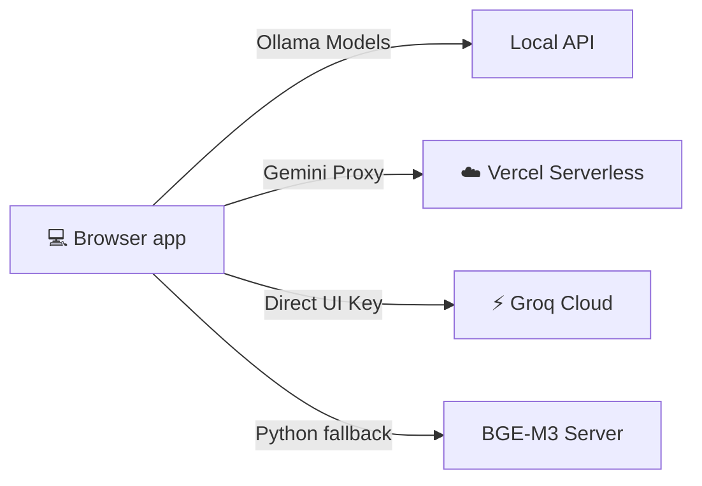

<div align="center">
  
  
  # 🔬 Co-Creation Provenance Lab

  **An open-source laboratory for auditing diversity, equity, and representation in AI-summarized participatory processes.**

  [](https://www.gnu.org/licenses/agpl-3.0)
  [](https://reactjs.org/)
  [](https://vitejs.dev/)
  [](https://www.typescriptlang.org/)
  
  [Overview](#overview) • [Key Features](#-key-features) • [Quick Start](#-quick-start) • [Architecture](#-architecture)
</div>

---

## 📖 Overview

When hundreds of diverse voices participate in co-creation, AI is often used to summarize the output. But **who gets left out?** 

The Co-Creation Provenance Lab is a diagnostic tool that measures whether every voice is captured fairly. It identifies blind spots, diagnoses the root cause of underrepresentation, and provides actionable recommendations for more inclusive summarization.

---

## ✨ Key Features

### ⚖️ Representation Auditing
* **Hybrid Scoring System** — Measures input representation using 80% semantic similarity (cosine similarity with exponential decay) + 20% concept overlap.
* **Blind Spot Detection** — Identifies genuinely missed unique voices based on semantic centrality and representation score.
* **Equity Metrics** — Live calculation of Gini coefficients, gap analysis, and coverage uniformity.
* **Leave-One-Out (LOO) Sensitivity** — Z-score normalized analysis showing which voices dictate the summary's direction.

### 🔍 Explainability & Trust
* **Citation Provenance Trail** — Click any AI-generated sentence to see the exact participant inputs that constructed it, ranked by match strength.
* **Bias Source Diagnosis** — Automatically categorizes underrepresentation into 4 root causes:
  * 🌍 *Embedding Gap* (Multilingual failure)
  * 👤 *Unique Voice* (Semantic isolation)
  * ❌ *Summarizer Bias* (Ignored relevant input)
  * 🗣️ *Phrasing Mismatch* (Non-standard expressions)
* **Actionable Recommendations** — Translates complex statistical metrics into plain-language facilitation advice.

### 🛠️ Action & Intervention
* **Facilitation Co-Pilot** — Generates an LLM-powered (or rule-based) workshop plan with targeted follow-up questions and exercises specifically designed to surface missed voices.
* **Consultation Planner (What-If Simulator)** — Run parametric bootstrap simulations to see how adding specific voices or reweighting stakeholder groups impacts equity.
* **Interactive Revision** — Edit the summary manually or via AI draft, and see Before/After equity metrics update live without re-embedding.

<details>
<summary><b>📊 Dive Deeper: Validation & Methodology Notes</b></summary>

* **Bootstrap Confidence Intervals:** 200-sample resampling for Gini and mean representation metrics to quantify sampling variability.
* **Language/Group Equity:** Includes an exact permutation test (10,000 runs) to verify non-English inclusion and inter-group Gini comparisons.
* **Clustering:** K-Means++ with automated Elbow-method selection; PCA using power iteration for 2D semantic maps.
* **Export Options:** Produces W3C PROV-O JSON-LD certificates and standalone HTML Executive Reports.
</details>

---

## 🧠 AI Providers & Embeddings

The tool dynamically connects to three different tiers of AI, entirely configurable from the UI.

| Provider | Summary Generation | Embeddings | Setup Requirement |
|:---|:---|:---|:---|
| ☁️ **Google Gemini** | ✅ Cloud (`text-embedding-004`) | ✅ High Quality | API key (free at [Google AI Studio](https://aistudio.google.com)) |
| ⚡ **Groq** | ✅ Cloud (Llama 3, Mixtral) | ❌ Falls back | API key (free at [Groq Console](https://console.groq.com)) |
| 💻 **Ollama** | ✅ Local Privacy | ✅ Local (`all-minilm`) | Install Ollama locally |

#### Automatic Embedding Fallback Strategy
Embeddings drive all scores. If a premium provider fails or isn't configured, the system gracefully degrades:
`BGE-M3 (SOTA Multilingual)` ➔ `Ollama` ➔ `Gemini` ➔ `Custom Local TF-IDF (WASM-accelerated)`

---

## 🚀 Quick Start (Local dev)

**Prerequisites:** Node.js v18+, Python 3.10+ (optional), Ollama (optional)

```bash
# 1. Clone & Install
git clone https://github.com/sachit27/co-creation-provenance-lab.git
cd co-creation-provenance-lab
npm install

# 2. Start the dev server
npm run dev
```
Open `http://localhost:3000` in your browser.

<details>
<summary><b>🐳 Want to use Docker instead?</b></summary>

```bash
docker compose up
# Or for Mac/Linux:
chmod +x start.sh && ./start.sh
```
</details>

<details>
<summary><b>🌍 Want to run the BGE-M3 Multilingual Embedding Server?</b></summary>

```bash
pip install sentence-transformers flask flask-cors
python embedding_server.py
```
*(Downloads ~2GB weights on first run. If `torch.load` error occurs: `pip install 'transformers<4.50'`)*
</details>

---

## 🏗️ Architecture & Performance

Built for client-side analytical scale and rapid iteration without burning cloud budget:

* **IndexedDB Vector Cache:** Achieves 100x speedups on page reloads and semantic searches using an LRU cache.
* **Batched Offline Inference:** Sentiment and NLP tasks run locally via WebAssembly HuggingFace DistilBERT models.
* **Adaptive Concurrency:** Internal API throttling automatically scales to respect Groq/Gemini rate limits.



<details>
<summary><b>📁 View Full Repository Structure</b></summary>

```text
co-creation-provenance-lab/
├── api/                             # Serverless proxy endpoints (Gemini)
├── components/                      # React UI
│   ├── ui/                          # Complex interactive panels (CoPilot, Trails)
│   └── visualizations/              # D3/Recharts (Maps, Fidelity, Gini)
├── services/                        
│   ├── analysis.ts                  # Core pipeline
│   ├── embeddingCache.ts            # IndexedDB caching
│   ├── huggingface.ts               # Offline WASM inference
│   ├── biasAttribution.ts           # Root-cause algorithms
│   └── ...                          # Provider APIs & metric calculators
├── embedding_server.py              # Dedicated BGE-M3 Python service
└── ...
```
</details>

---

## 💡 How to Use

1. **Load Data:** Upload a CSV (`id`, `text`, `stakeholder_group`), or try the built-in Benchmarks.
2. **Configure:** Pick your AI provider, model, and summarization strategy (Balanced / Diversity / Consensus).
3. **Audit:** Let the AI generate the summary. Review your **Executive Scorecard**, Semantic Map, and Provenance Trails.
4. **Intervene:** Open the **Facilitation Co-Pilot** to get workshop exercises targeting your blind spots.
5. **Iterate:** Use the **Simulate & Revise** tools to test the impact of adding specific voices.

---

## 🤝 Contributing & License

This project is licensed under the **GNU Affero General Public License v3.0 (AGPL-3.0)**. 
Developed by **Sachit Mahajan** ✉️ [sachitmahajan90@gmail.com](mailto:sachitmahajan90@gmail.com)
