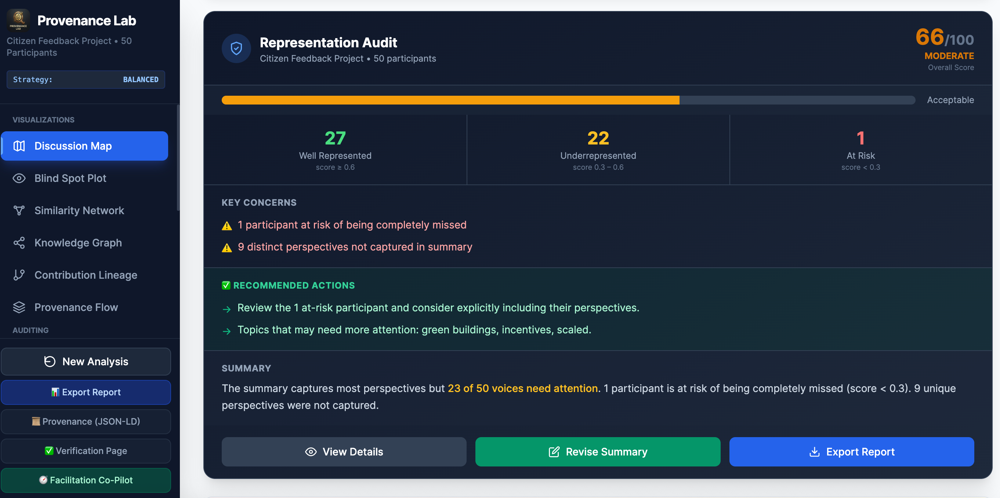
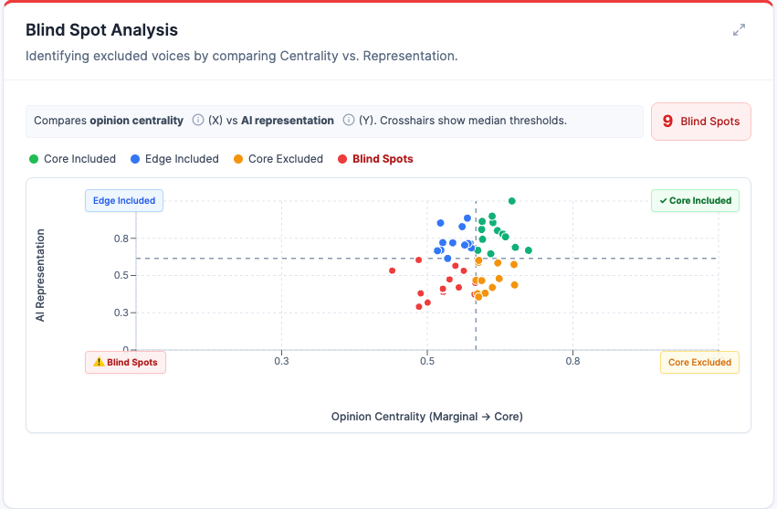
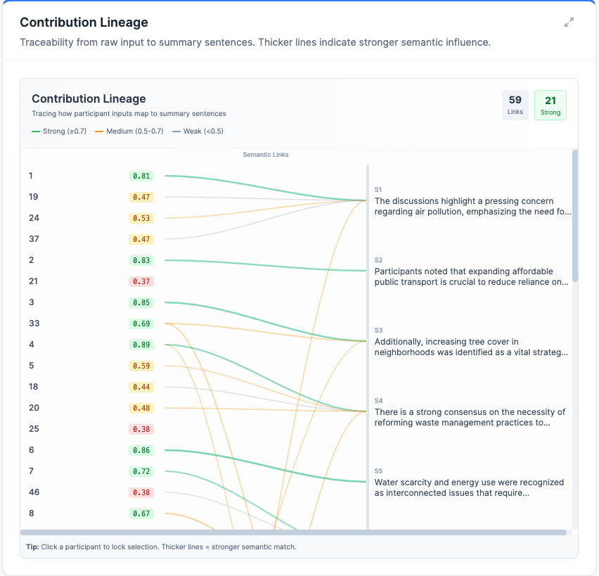
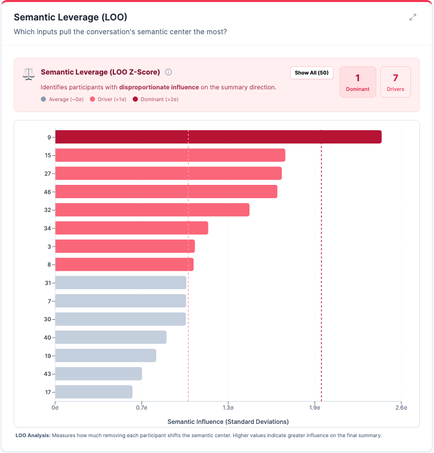
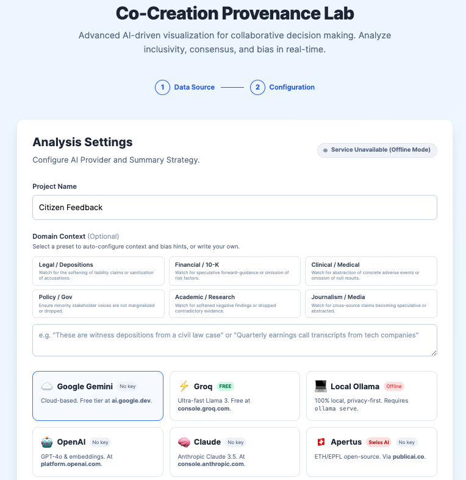

<div align="center">


<br/>

# Provenance Lab

**Open-source visual analytics for auditing AI-generated summaries.**<br/>
Trace whose voice was captured, whose was lost, and why.

<br/>

[](https://co-creation-provenance-lab.vercel.app)

[](https://www.typescriptlang.org/)
[](https://react.dev/)
[](https://vitejs.dev/)
[](https://www.gnu.org/licenses/agpl-3.0)

<br/>

[The Problem](#the-problem) &nbsp;&middot;&nbsp; [How It Works](#how-it-works) &nbsp;&middot;&nbsp; [Features](#features) &nbsp;&middot;&nbsp; [Quick Start](#quick-start) &nbsp;&middot;&nbsp; [AI Providers](#ai-providers) &nbsp;&middot;&nbsp; [Methodology](#methodology)

<br/>



<sub>Representation Audit dashboard showing per-participant scoring, equity metrics, and actionable recommendations.</sub>

</div>

<br/>

## The Problem

Large Language Models are increasingly used to synthesize complex inputs — stakeholder consultations, survey responses, research literature, community feedback. But **synthesis is inherently reductive**:

- Majority viewpoints get amplified; minority perspectives get flattened
- Nuances in interpretation are smoothed over without disclosure
- The distance between original evidence and final summary is invisible
- There is no way to verify *whose voice* shaped *which claim*

**Provenance Lab makes this visible.** It is an auditing engine that produces a complete, mathematically grounded provenance trail between source documents and any AI-generated summary — making representation equity quantifiable, interpretive leaps explicit, and the entire synthesis process transparent.

<br/>

## How It Works

```
  Upload CSV              AI Generates             Provenance Engine            Visual Dashboard
  ┌──────────┐           ┌──────────────┐          ┌───────────────┐           ┌──────────────┐
  │ Participant │  ───>   │   Summary    │   ───>   │  Embed, Score │   ───>   │ 16 Analytical│
  │ Responses  │         │  (any LLM)   │          │  Trace, Audit │          │    Views     │
  └──────────┘           └──────────────┘          └───────────────┘           └──────────────┘
```

1. **Upload** participant responses as CSV (auto-detects columns, handles messy data)
2. **Summarize** using any AI provider — or paste an existing summary
3. **Audit** — the engine computes representation scores, detects blind spots, traces claim provenance
4. **Explore** — 16 interactive visualizations reveal exactly what happened during synthesis

> **Privacy-first**: All analysis can run entirely in-browser. No data leaves your machine unless you opt into a cloud LLM provider.

<br/>

## Features

Provenance Lab provides **16 analytical views** organized into four layers:

### Representation & Equity

<table>
<tr>
<td width="50%">

**Discussion Map** — 2D semantic projection (PCA) of all participant inputs, colored by representation score. Reveals clustering, isolation, and which regions of the opinion space the summary covers.

**Blind Spot Analysis** — Quadrant scatterplot (Centrality vs. Representation) that identifies voices the summary ignored despite being topically relevant.

**Equity Distribution** — Lorenz curves, Gini coefficient, and bootstrap confidence intervals measuring how fairly representation is distributed.

</td>
<td width="50%">

<sub>Blind Spot Analysis: identifying excluded voices by comparing opinion centrality against AI representation.</sub>
</td>
</tr>
</table>

### Provenance & Traceability

<table>
<tr>
<td width="50%">

<sub>Contribution Lineage: tracing each participant's semantic influence on specific summary sentences.</sub>
</td>
<td width="50%">

**Contribution Lineage** — Interactive flow diagram showing which participants influenced which summary sentences, with line thickness proportional to semantic similarity.

**Provenance Sankey** — Sankey diagram tracing the flow of concepts from raw input through semantic themes to final summary sentences.

**Knowledge Graph** — Entity-relationship graph extracted from participant texts using Louvain community detection, revealing the conceptual structure of the discussion.

</td>
</tr>
</table>

### Language & Rhetoric

<table>
<tr>
<td width="50%">

**Language Fidelity** — Tracks how the original language was transformed: preserved, softened, sanitized, abstracted, or dropped. Includes an emotion smoothing matrix showing where the AI neutralized strong sentiment.

**Claim Attribution** — FActScore-inspired analysis mapping each summary claim to supporting, inferrable, or unsupported evidence in the source texts.

**Tension Network** — Detects conflicting viewpoints in the source data and tracks whether the AI acknowledged, suppressed, merged, or distorted those contradictions.

**Rhetorical Influence** — Spearman correlation test between communication style (assertiveness, register, evidentiality) and representation score, detecting systematic bias in how the summarizer treats different voices.

</td>
<td width="50%">

<sub>Semantic Leverage (LOO): measuring each participant's influence on the conversation's semantic center.</sub>
</td>
</tr>
</table>

### Statistical Robustness

| View | What it measures |
|:---|:---|
| **Sensitivity (LOO)** | Leave-one-out analysis identifying which single input has the most leverage over the summary's semantic centroid |
| **Uncertainty Quantification** | Bootstrap confidence intervals (1000 samples) for all key metrics, with Monte Carlo stability analysis |
| **Group Equity** | Between-group representation gaps when stakeholder categories (e.g., community, government, business) are present |
| **Strategy Comparison** | Side-by-side comparison of different summarization strategies on the same data |
| **PROV-O Export** | W3C PROV-O JSON-LD audit certificate for reproducibility and formal provenance documentation |

<br/>

## Quick Start

**Prerequisites:** Node.js 18+

### Local Development

```bash
git clone https://github.com/sachit27/co-creation-provenance-lab.git
cd co-creation-provenance-lab
npm install
npm run dev
```

Open `http://localhost:3000`. The tool works immediately with built-in demo datasets and local TF-IDF embeddings — **no API key required**.

<details>
<summary><b>Run with Docker</b></summary>

```bash
docker compose up
```

</details>

<details>
<summary><b>High-fidelity multilingual embeddings (optional)</b></summary>

For state-of-the-art multilingual analysis, run the local BGE-M3 embedding server:

```bash
pip install sentence-transformers flask flask-cors
python embedding_server.py
```

This provides 1024-dimensional multilingual embeddings supporting 100+ languages — no API key required.

</details>

<br/>

## AI Providers

Provenance Lab is **model-agnostic**. Bring your own API key or run fully offline.

| Provider | Summary Generation | Embeddings | Privacy |
|:---|:---:|:---:|:---|
| **Ollama** (local) | Yes | Yes | Fully private — nothing leaves your machine |
| **BGE-M3** (local Python) | — | Yes | Fully private |
| **TF-IDF** (built-in) | — | Yes | Fully private |
| **Google Gemini** | Yes | Yes | Cloud API |
| **OpenAI** | Yes | Yes | Cloud API |
| **Anthropic Claude** | Yes | — | Cloud API |
| **Groq** (free tier) | Yes | — | Cloud API |
| **Apertus** (Swiss National AI) | Yes | — | Cloud API |

> API keys are stored in `sessionStorage` only — never persisted to disk or transmitted to our servers.

<br/>

## Methodology

<details>
<summary><b>Representation Scoring</b></summary>

<br/>

Each participant's representation score combines two signals:

**Embedding similarity** — Cosine similarity between the participant's text embedding and each summary sentence embedding. The best-matching sentence provides the primary score; secondary matches are decay-weighted (gamma = 0.3) to penalize redundant coverage and reward unique representation.

**Concept overlap** — Porter-stemmed keyword intersection between participant text (extracted via RAKE) and summary text, normalized by the participant's total keyword count.

The final score is a weighted combination, normalized by geometric series sum to avoid ceiling effects.

</details>

<details>
<summary><b>Sentiment Analysis</b></summary>

<br/>

Three-tier fallback for robust sentiment scoring regardless of API availability:

1. **LLM-based** (Tier 1) — Context-aware scoring via the selected AI provider
2. **HuggingFace Transformers** (Tier 2) — SOTA models running in-browser via ONNX/WASM
3. **AFINN lexicon** (Tier 3) — VADER-inspired rule-based scoring with negation handling (3-token window) and intensifier support

</details>

<details>
<summary><b>Statistical Methods</b></summary>

<br/>

- **Bootstrap confidence intervals**: 1000 resamples per Efron & Tibshirani for all key metrics
- **Spearman rank correlation**: With permutation test (999 permutations, Fisher-Yates shuffle) for small samples (n <= 30), t-distribution approximation for larger samples
- **Louvain community detection**: Modularity-optimized clustering with proper null-model penalty for non-edges
- **MinHash/LSH**: Near-duplicate detection with integer-safe hashing (prime = 104729)
- **Gini coefficient**: Representation inequality measurement with trapezoidal integration

</details>

<details>
<summary><b>Embedding Tier System</b></summary>

<br/>

The tool automatically selects the best available embedding method:

| Tier | Method | Dimensions | Quality |
|:---:|:---|:---:|:---|
| 1 | BGE-M3 (local Python server) | 1024 | Research-grade multilingual |
| 2 | Gemini / OpenAI API embeddings | 768–3072 | High quality |
| 3 | TF-IDF (built-in, no setup) | 150 | Baseline — always available |

</details>

<br/>

## Input Format

Upload a CSV file with participant responses. The tool auto-detects columns:

```csv
id,text,group
P1,"We need more green spaces in the city center",community
P2,"Budget constraints limit infrastructure expansion",government
P3,"Mixed-use development could address both concerns",business
```

- **id** — Participant identifier (optional, auto-generated if missing)
- **text** — The participant's response (required)
- **group** — Stakeholder category for group equity analysis (optional)

Works with or without headers. Handles messy data, encoding issues, and varied delimiters.

<br/>

## Project Structure

```
co-creation-provenance-lab/
  components/
    ui/                    # Dashboard panels, config, onboarding
    visualizations/        # 16 analytical view components
  services/
    analysis.ts            # Core analysis pipeline
    completionRouter.ts    # Multi-provider LLM routing with timeout
    sentiment.ts           # 3-tier sentiment analysis
    rhetoricalAnalysis.ts  # Rhetorical influence & bias detection
    claimAttribution.ts    # FActScore-inspired claim tracing
    graphRAG.ts            # Knowledge graph & Louvain clustering
    mathUtils.ts           # Statistical primitives (Gini, PCA, bootstrap)
    textUtils.ts           # Porter stemmer, RAKE, concept overlap
  api/                     # Vercel serverless functions (proxy)
  public/                  # Static assets & demo data
```

<br/>

## License & Contributing

Contributions are welcome. Please open an issue before submitting large architectural changes.

- **License:** [GNU AGPL v3.0](LICENSE)
- **Author:** Sachit Mahajan — [sachitmahajan90@gmail.com](mailto:sachitmahajan90@gmail.com)

<div align="center">

<br/>



<sub>Configuration panel with support for 8 AI providers and built-in demo datasets.</sub>

<br/><br/>

</div>
