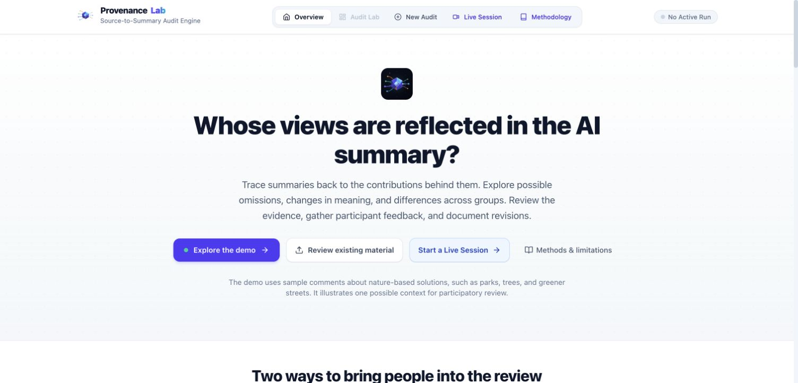

<div align="center">


# Provenance Lab

**Whose views are reflected in the AI summary?**

Trace source contributions, inspect possible omissions and changes in meaning, gather participant feedback, and document revisions.

[Explore the demo](https://sachit27.github.io/apps/provenance-lab/) · [Get started](#run-locally) · [Methodology](docs/methodology.md) · [Live sessions](docs/live-sessions.md)

</div>



## From a smooth summary to inspectable evidence

Summaries bring many contributions into a smaller space. A readable result can still lose conditions, disagreements, or the details that matter to someone. Provenance Lab gives researchers, facilitators, cities, and policy teams a way to inspect those changes and keep a record of the review.

Use it with public consultations, participatory workshops, research synthesis, or organizational feedback. Bring an existing summary, generate a draft, or collect contributions during a live session.

## What you can do

| Your question | What the app provides |
|---|---|
| Where might a contribution appear in the summary? | Interactive source-to-sentence matches with the original wording alongside candidate passages |
| Which perspectives need a closer look? | Alignment distributions, group comparisons, and an evidence review queue |
| Has wording or emphasis changed? | Source-language and claim-evidence reviews with explicit unassessed cases |
| Were competing proposals acknowledged? | Exact-source tension candidates for human inspection |
| Does a revision address the concern? | Before/after wording, separately recalculated scores, and retained version history |
| How do contributors feel represented? | Optional participant feedback, with live surveys controlled and customized by the facilitator |
| Can the review be shared? | JSON session records, HTML reports, and unsigned W3C PROV-O-aligned JSON-LD exports |

**Read the evidence alongside the indicators.** Semantic similarity helps locate candidate connections. It does not establish agreement, authorship, causal influence, complete coverage, or fairness. Automated assessments can be wrong; the review queue lets an analyst record decisions and reasons. [Methods and limitations](docs/methodology.md) explain each measure and its scope.

## Try the saved demo

[Open the interactive demo](https://sachit27.github.io/apps/provenance-lab/) without an API key. It contains 40 synthetic consultation comments about trees, flooding, biodiversity, and community stewardship. Nature-based solutions are the example dataset; the tool supports other contexts.

Explore the source text, summary matches, review queue, and **Compare saved revision**. The revision was separately scored, so you can inspect changed wording and alignment without another model call. Generation and automated review used `gpt-4o-mini`, with `text-embedding-3-small` embeddings. This is an illustrative workflow, not an independently validated benchmark or participant-approved synthesis.

## Run locally

Use Node.js 22.18 or newer.

```bash
git clone https://github.com/sachit27/co-creation-provenance-lab.git
cd co-creation-provenance-lab
npm ci
npm run dev
```

Open `http://localhost:5173`. Manual and extractive summaries with local TF-IDF alignment need no provider key. AI generation, dense embeddings, and automated reviews require their configured services.

1. **Add contributions:** paste text, upload CSV/TSV/TXT, provide multiple documents, or split a document into sections.
2. **Choose the summary:** paste existing text and declare its origin, generate an AI draft, or use an extractive comparison.
3. **Run and review:** inspect the overview, source matches, and advanced evidence in the audit lab.
4. **Revise and export:** record review decisions, compare revisions, and save the audit record.

### Input example

```csv
id,text,group
P1,"Preserve shaded walking routes for older residents",community
P2,"Any proposal must fit the existing budget",government
P3,"Provide protected bike lanes and a skate park",youth
```

IDs and groups are optional. Preview the selected columns and excluded rows before running. Keep question context when short responses depend on it.

### Facilitate a live session

```bash
npm run live:dev
```

Create a session, share a link or QR code, and open input. Participants can edit their responses until the facilitator closes input. Review the audit, revise if needed, and publish results to participant devices. Switch the optional survey on when ready; edit the template, anchors, or questions to suit the session. The session download retains publications, review history, survey definitions, and feedback.

Phones need a reachable server address on the same network or an appropriate hosted service. GitHub Pages serves the static audit app and saved demo; it cannot run the shared session server. Live mode currently supports a local or single-process pilot. Read the [setup and deployment guide](docs/live-sessions.md) before hosting a workshop.

## Providers and data

Generation, evaluation, and embedding services can be configured separately. The run record captures requested methods, effective methods, and available provider metadata.

| Service | Generation / evaluation | Embeddings | Destination |
|---|:---:|:---:|---|
| Ollama | Yes | Yes | Configured Ollama host |
| BGE-M3 | — | Yes | Configured embedding service |
| TF-IDF | — | Yes | Browser only |
| OpenAI | Yes | Yes | OpenAI API |
| Google Gemini | Yes | Yes | Google API |
| Anthropic Claude | Yes | — | Anthropic API |
| Groq | Yes | — | Groq API |
| Apertus / PublicAI | Yes | — | PublicAI via the local development proxy |

Cloud services receive the text sent to them. Browser-entered keys are held in the current tab's `sessionStorage` and are accessible to page JavaScript and browser extensions. Production builds contain no shared provider keys. Live session files remain on the operator's server; published summaries and pseudonymous visual data can reveal information from contributions. Choose services and access controls appropriate to the material.

## Development and deployment

```bash
npm run verify     # Regression tests, TypeScript checks, and production build
npm run build      # Static build in dist/
npm run live:serve # Serve the built app with the live session API
```

For the existing GitHub Pages path:

```bash
VITE_BASE_PATH=/apps/provenance-lab/ npm run build
```

Deploy the contents of `dist/` to that site's `apps/provenance-lab/` directory. Keep `.env`, private session files, and research data outside the published files.

The saved demonstration has offline validation commands:

```bash
npm run demo:validate -- public/demo-result.json
npm run demo:validate -- public/demo-revision.json public/demo-result.json
```

`demo:generate` and `demo:revise` create candidate artifacts and may make paid provider calls. Inspect and validate candidates before replacing the saved demo.

## Citation

If you use this work, please cite:

```bibtex
@article{mahajan2026participatory,
  title={Participatory provenance as representational auditing for AI-mediated public consultation},
  author={Mahajan, Sachit},
  journal={arXiv preprint arXiv:2604.20711},
  year={2026},
  url={https://arxiv.org/abs/2604.20711}
}

@article{mahajan2025measuring,
  title={Participatory Provenance: Measuring Input Transformation in AI-Mediated Collective Synthesis},
  author={Mahajan, Sachit},
  journal={SSRN},
  year={2025},
  url={https://papers.ssrn.com/sol3/papers.cfm?abstract_id=5709064}
}
```

## License

[GNU Affero General Public License v3.0](LICENSE). Contributions are welcome through issues and pull requests.

Author: Sachit Mahajan, [sachitmahajan90@gmail.com](mailto:sachitmahajan90@gmail.com)
