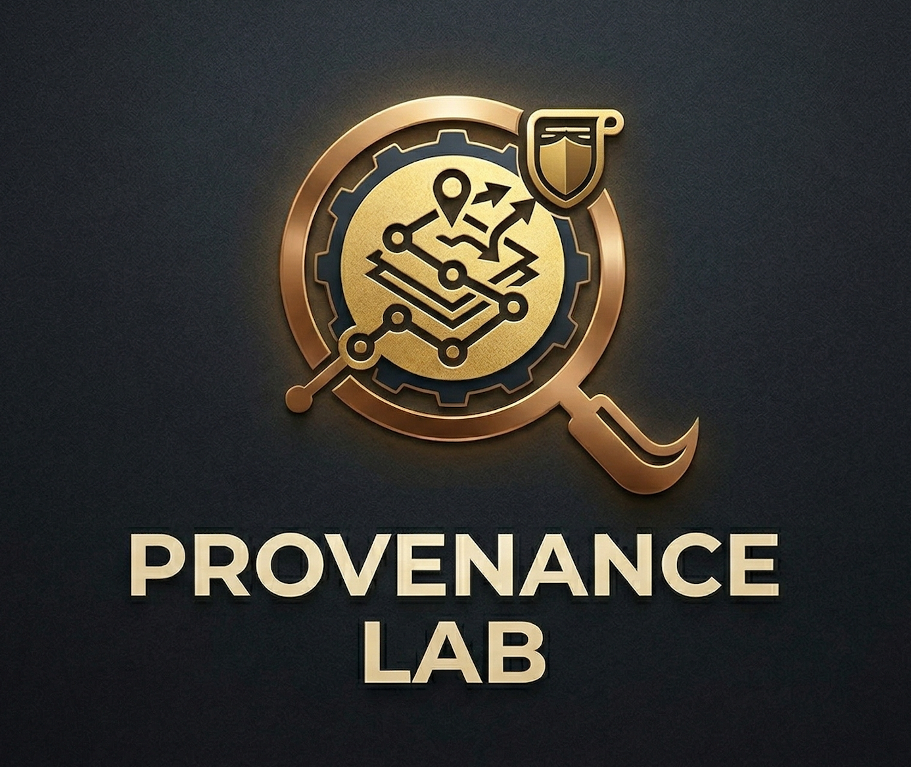

<div align="center">



# Provenance Lab

**Visual analytics for inspecting source-to-summary representation.**

[](https://sachit27.github.io/apps/provenance-lab/)

[](https://www.typescriptlang.org/)
[](https://react.dev/)
[](https://vite.dev/)
[](https://www.gnu.org/licenses/agpl-3.0)

</div>

## Purpose

Provenance Lab audits how a summary relates to a collection of source contributions. It records how a run was executed, computes source-to-summary semantic-alignment indicators, and presents evidence for review at participant, sentence, claim, group, and discourse levels.

The application does **not** establish authorship, causal influence, factual entailment, fairness, or a participant's internal emotional state. Similarity links and model-coded labels are review evidence. They are not verified derivations or human judgments.

## Hosted demonstration

The [GitHub Pages application](https://sachit27.github.io/apps/provenance-lab/) retains the existing precomputed audit of 30 bundled contributions. That artifact was produced through the application pipeline with:

- `qwen2.5:14b` for summary generation
- `phi4:14b` for automated model-coded review
- `qwen3-embedding:8b` for semantic embeddings

That archived run did not pass the current clustering validity gates, so its cluster-dependent views remain unavailable. Starting a **New Analysis** loads a separate 40-record synthetic tutorial fixture with four planted themes and four mixed-theme records. It is designed to exercise validated grouping and cross-group connector workflows with the user's configured models; it is not evaluation evidence.

The hosted site has no Vercel backend and no shared server-side API keys. Running a new analysis requires a compatible browser-direct provider, a safely configured Ollama endpoint, or a local installation. Browser-entered credentials are stored only in the current tab's `sessionStorage`, but they remain accessible to the page's JavaScript and browser extensions.

## Workflow

1. **Ingest sources.** Use a sample dataset, paste text, upload CSV/TSV/TXT, provide multiple documents, or split a single document.
2. **Declare the summary origin.** Generate a summary with a configured model, create a deterministic extractive summary, or paste an existing summary and record its known provenance.
3. **Choose methods.** Configure the generator, automated evaluator, and embedding method separately. The run manifest records requested and effective methods and available provider metadata.
4. **Run the core audit.** The application segments the summary, embeds sources and summary sentences, computes maximum-sentence semantic alignment, and reports descriptive inequality and source-space diagnostics.
5. **Run optional automated reviews.** When an evaluator is available, the application can assess source-unit transformations, affective expression, claim evidence, sampled tensions, rhetoric markers, and graph entities. Missing or malformed model outputs remain explicit.
6. **Inspect and export.** Review participants and evidence, revise a summary, collect locally returned participant responses, export an HTML report, or create an unsigned PROV-aligned JSON-LD record with integrity digests.

## Interface

The sidebar has 16 analytical views in four workspaces. Views appear only when the required data exists.

| Workspace | Views | Interpretation |
|---|---|---|
| Overview & Triage | Inclusion Metrics, Alignment Quadrants, Uncertainty, Group Comparison | Descriptive alignment levels, inequality, resampling stability, and configured-group differences |
| Participant & Topic Spaces | Discussion Map, Similarity Network, Knowledge Graph | Source-space geometry and model-extracted concepts; clustering appears only after internal validity gates pass |
| Associations & Evidence | Contribution Matches, Association Map, Claim Evidence, Sentence–Source Similarity | Semantic retrieval candidates and model-coded evidence for inspection, without causal or citation claims |
| Discourse & Counterfactual Audit | Source-unit Transformation, Tension Mapping, Rhetoric–Alignment Association, Sensitivity (LOO), Compare Strategies | Optional transformation and discourse reviews plus descriptive source-space and strategy analyses |

Additional workflow panels support summary revision, participant-response import/export, facilitation suggestions, and budgeted counterfactual utility attribution. Cluster-level functions are disabled when no partition passes the documented gates.

## Core measures and boundaries

For source vector `p_i` and summary-sentence vectors `s_k`, the representation indicator is `R_i = max_k max(0, cosine(p_i, s_k))`. It measures the strongest sentence-level semantic similarity found for each source. It does not measure whether the summary agrees with the source, whether the source caused the wording, or whether every claim in a long source was retained.

- **Gini coefficient** describes inequality among valid alignment indicators.
- **Participant resampling** describes stability under resampling of the observed records. It is not automatically a population confidence interval.
- **Alignment quadrants** use a descriptive median split of source centrality and alignment.
- **Sensitivity (LOO)** measures movement of the source-space centroid when one record is removed. It is not influence on the generated summary.
- **Clustering** reports a partition only after sample-size, separation, minimum-size, restart, subsample, neighborhood, method-sensitivity, and projection checks pass.
- **Affective-expression review** compares model-coded, target-aware profiles of observable text. It does not infer a person's emotions and is not a generic emotion-smoothing score.
- **Counterfactual utility attribution** evaluates a defined stochastic summary-coverage utility. It is not causal identification from observational data.

The full definitions and limitations are in [docs/methodology.md](docs/methodology.md).

## Local installation

Requirements: Node.js 18 or newer.

```bash
git clone https://github.com/sachit27/co-creation-provenance-lab.git
cd co-creation-provenance-lab
npm install
npm run dev
```

Open `http://localhost:5173`.

No API key is required for sample data, manual or extractive summaries, and the built-in TF-IDF baseline. Model-coded enrichment requires a working evaluator. Local Vite development proxies Ollama at `http://localhost:11434` and PublicAI/Apertus requests to avoid browser cross-origin restrictions.

### Optional local dense embeddings

```bash
pip install -r requirements-embedding.txt
python embedding_server.py
```

This starts the local BGE-M3 service. Its suitability still needs validation for the intended language and domain.

### Verification

```bash
npm run verify
```

This runs the deterministic regression suite, TypeScript checks, and the production build. The separate empirical research evaluation is intentionally maintained outside the public GitHub repository.

### Rebuild the bundled demonstration

With the documented Ollama models installed:

```bash
OLLAMA_HOST=http://127.0.0.1:11434 npm run demo:generate
```

The command refuses to replace the existing artifact if the semantic partition is unavailable, the connector set is empty, required stages fail, or a configured model silently falls back. It is optional; the tracked archived demo remains unchanged until this command completes successfully.

## Input format

```csv
id,text,group
P1,"We need more green spaces in the city center",community
P2,"Budget constraints limit infrastructure expansion",government
P3,"Mixed-use development could address both concerns",business
```

`id` and `group` are optional. The interface previews detected columns and preprocessing decisions before analysis. Data cleaning is consequential: inspect excluded records and preserve question context when short answers depend on it.

## Providers and data destinations

| Method | Generation | Embeddings | Where data goes |
|---|:---:|:---:|---|
| Ollama | Yes | Yes | Configured Ollama host |
| BGE-M3 service | No | Yes | Configured local or organizational service |
| TF-IDF | No | Yes | Browser only |
| Google Gemini | Yes | Yes | Google API when a user key is supplied |
| OpenAI | Yes | Yes | OpenAI API when a user key is supplied |
| Anthropic Claude | Yes | No | Anthropic API when a user key is supplied |
| Groq | Yes | No | Groq API when a user key is supplied |
| Apertus via PublicAI | Yes | No | PublicAI through the local development proxy; the static hosted demonstration has no relay |

Cloud providers receive the text sent for generation or automated review. Review provider retention, logging, access controls, and organizational policy before processing sensitive material. A local model is private only when its configured host and surrounding infrastructure are controlled appropriately.

## Repository layout

```text
components/       Interface panels and visualizations
services/         Analysis, provider adapters, statistics, and exports
api/              Optional serverless relay handlers; not active on GitHub Pages
public/           Static assets and the precomputed demonstration
scripts/          Reproducible demo generation
tests/            Deterministic application regression tests
docs/             Methodology and deployment documentation
```

## License

[GNU Affero General Public License v3.0](LICENSE). Contributions are welcome through issues and pull requests.

Author: Sachit Mahajan, [sachitmahajan90@gmail.com](mailto:sachitmahajan90@gmail.com)
